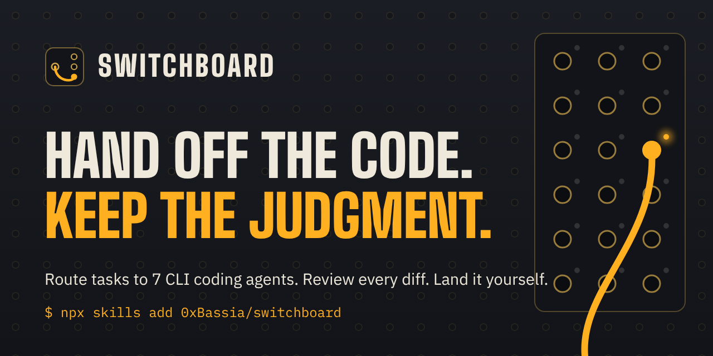
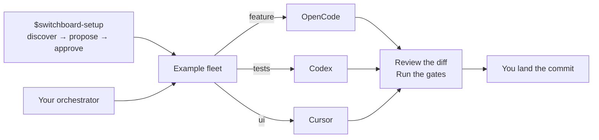

<p align="center">
  
</p>

# Switchboard

[](https://github.com/0xBassia/switchboard/actions/workflows/relays.yml)
[](LICENSE)

**Hand off the code. Keep the judgment.**

Switchboard lets the coding agent you already work with delegate a task to any of 7 CLI coding agents:
Claude Code, Codex, Cursor, OpenCode, Pi, Oh My Pi and Warp. The implementer does the typing.
Your agent gets back a structured report and the diff, re-runs your project's tests, and lands the
work itself. Nothing is committed without that review.

```bash
npx skills add 0xBassia/switchboard
```

Requires Node 18+, git 2.31+, and at least one implementer CLI on your PATH (see [Requirements](#requirements)).

Then ask your orchestrating agent to set up lanes:

```text
Use $switchboard-setup to discover my installed implementer CLIs and create a fleet for feature, tests, and UI work.
```

Or delegate directly:

```text
Use $switchboard-codex to have Codex implement the refactor in services/billing/, then review and commit it.
```



## Why Switchboard

- **7 implementers, one result format.** Each CLI is its own skill with its real flags. Every run
  writes the same `switchboard-relay.result.v1` record, so your agent reviews them all the same way.
- **One engine under every relay.** All relays are generated from a shared engine in `src/core/`, so
  a safeguard lands for every implementer at once:
  - `result.json` is written atomically on every outcome: completed, failed, timeout, stalled,
    aborted, or unavailable;
  - the watchdog stops the whole process tree, and an opt-in stall watchdog stops an agent that has
    gone silent;
  - a CLI whose version check fails is never sent the brief;
  - run artifacts are private (0700 directory, 0600 files) and never written through a symlink;
  - a read-only run proves it wrote nothing: the 6 relays with a read-only mode (every implementer
    but Warp) fingerprint the Git working tree before and after, and count a commit, a ref move, or a
    changed Git setting that can run commands as a violation;
  - after the implementer exits, the relay kills any process it left behind (see
    [Trust and validation](#trust-and-validation));
  - token counts and cost land in one `tokens` / `totalCostUsd` shape wherever the CLI reports them.
- **Lanes.** Route reviews, refactors and bulk work to different implementers with
  `switchboard-fleet.v1` lanes. Setup writes nothing until you approve.
- **You keep the commit.** Relays never commit. Your agent reviews, re-runs the gates, and lands.
- **Inspectable.** Each relay is one readable Node file: no dependencies, no telemetry, no network
  calls of its own.

## Choose how you delegate

### Create a fleet

| Skill | Job |
| --- | --- |
| [`switchboard-setup`](skills/switchboard-setup/SKILL.md) | Discover installed CLIs, propose **fleet lanes**, and write global or project config after you approve. Never dispatches work. |

A **fleet** is your set of named lanes. Each **lane** binds a kind of work to one implementer and
optional dials such as model, effort, or variant. Setup discovers what is available, proposes a compact
fleet, shows you the complete configuration, and writes only after explicit approval.

Configuration can apply globally or to one repository. Once it is ready, dispatch with the matching
implementer skill and `--lane <name>`. Explicit flags override lane dials, and the wrong implementer
skill for a lane fails loud. Project config is content-bound to explicit setup approval, so cloned or
edited project lanes fail closed until re-approved. See the
[`switchboard-fleet.v1` schema](skills/switchboard-setup/references/schema.md) for paths, supported dials,
and overlay behavior.

### Delegate directly

Skip setup when you want one implementer or one-off dials. Pick the skill for a CLI you have:

| Skill | Implementer CLI | Write access (default) | Read-only run | Resume |
| --- | --- | --- | --- | --- |
| [`switchboard-claude`](skills/switchboard-claude/SKILL.md) | [Claude Code](https://code.claude.com/docs/en/overview) (`claude`) | `acceptEdits` + explicit tool surface | `--read-only` (`plan` mode) | `--resume-last`, `--session <id>` |
| [`switchboard-codex`](skills/switchboard-codex/SKILL.md) | [OpenAI Codex](https://github.com/openai/codex) (`codex`) | `--sandbox workspace-write` | `--read-only` | `--resume-last`, `--session <id>` |
| [`switchboard-cursor`](skills/switchboard-cursor/SKILL.md) | [Cursor Agent](https://cursor.com/cli) (`cursor-agent`) | `--force`; `--no-force` withholds command approval | `--read-only` (plan mode) | `--resume-last`, `--session <id>` |
| [`switchboard-opencode`](skills/switchboard-opencode/SKILL.md) | [OpenCode](https://opencode.ai) (`opencode`) | agent `build` (`--model` required) | `--read-only` (agent `plan`) | `--resume-last`, `--session <id>` |
| [`switchboard-pi`](skills/switchboard-pi/SKILL.md) | [Pi](https://github.com/earendil-works/pi-mono) (`pi`) | full local tools — no sandbox, no permission modes [^none]; project trust opt-in | `--read-only` (`read,grep,find,ls`) | `--resume-last`, `--session <id>` |
| [`switchboard-omp`](skills/switchboard-omp/SKILL.md) | [Oh My Pi](https://github.com/can1357/oh-my-pi) (`omp`) | `--yolo` (`tools.approvalMode: yolo`); project `.omp` extras off unless `--approve` | `--read-only` (`read,grep,glob`) | `--resume-last`, `--session <id>` |
| [`switchboard-warp`](skills/switchboard-warp/SKILL.md) | [Warp Agent CLI](https://docs.warp.dev/cli/) (`oz`) | full local tools — no sandbox, no permission modes [^none] | — [^none] | `--conversation <id>` |

[^none]: No CLI-enforced read-only mode. `touchedFiles` and the diff are what you review against, not
a guarantee: they are post-run `git status` in the workspace, so they cannot show ignored files,
reverted edits, or writes outside the repository.

Each skill name links to its `SKILL.md`, which owns that implementer's prerequisites, flags, and
caveats. Building one for another CLI? [Claim it first](https://github.com/0xBassia/Switchboard/issues?q=is%3Aissue+label%3Aimplementer),
then see [CONTRIBUTING.md](CONTRIBUTING.md).

## Run tasks in parallel

[`switchboard-queue`](skills/switchboard-queue/SKILL.md) runs a batch of briefs at once through the installed
implementer relays, each task in its own git worktree, and writes one result file. A task names a
`lane` (from `switchboard-setup`) or an `implementer`, and may list `fallback` targets that are tried only
when the previous CLI was never dispatched (missing, or failed its version preflight). A run that started
and then failed is reported, not retried. A task can set `"review"` to have a second implementer
cross-review the result read-only; the queue is `completed` only if every review approves, and you still
review the diff yourself before you land it.

```json
{
  "version": "switchboard-queue.v1",
  "concurrency": 3,
  "tasks": [
    { "id": "billing", "brief": "briefs/billing.md", "lane": "feature", "fallback": ["bulk"] },
    { "id": "tests", "brief": "briefs/tests.md", "implementer": "codex", "args": ["--timeout", "45m"],
      "review": { "lane": "review" } }
  ]
}
```

```bash
node <skill-dir>/scripts/queue.mjs run queue.json --cd <repo>
# review each worktree's diff, re-run your gates, land what passes, then:
node <skill-dir>/scripts/queue.mjs cleanup <out-dir>/queue-result.json
```

The queue never commits. Worktrees start from `HEAD`, so uncommitted changes are not in them (the queue
warns). Cleanup never forces: a worktree with uncommitted work, or an unmerged branch, is kept and listed.

Some limits to know:

- Task ids that differ only by letter case are refused, so two tasks never share a directory on a
  case-insensitive filesystem.
- If the repository's hooks or Git settings that can run commands change during the queue run, the
  queue skips the review diff and refuses to create new worktrees.
- Warp (`oz`) has no read-only mode, so it can be a queue task but not a reviewer.
- A review brief carries at most 200,000 characters of diff.

## Install

Browse first:

```bash
npx skills add 0xBassia/switchboard --list
```

Install the package, the setup skill, or one implementer skill:

```bash
npx skills add 0xBassia/switchboard
npx skills add 0xBassia/switchboard --skill switchboard-setup
npx skills add 0xBassia/switchboard --skill switchboard-codex
```

To pin an installation, append an existing release tag as `@vMAJOR.MINOR.PATCH`. The Skills CLI
installs by git ref, not by `metadata.version` in `SKILL.md`.

Install for a specific agent, or globally:

```bash
npx skills add 0xBassia/switchboard --skill switchboard-codex --agent claude-code
npx skills add 0xBassia/switchboard --global
```

Works with any orchestrating agent the [Skills CLI](https://github.com/vercel-labs/skills) supports.

## How delegation works

Whether you choose the implementer directly or through a fleet lane, every dispatch follows the same
review-first loop:

1. **Write a brief** — self-contained task context; the implementer has no orchestrator chat history.
2. **Dispatch** it with the bundled `relay.mjs`.
3. **Wait** for completion — the relay writes a structured `result.json`.
4. **Review** the diff — re-run the project's gates yourself, and pair it with your own review skills.
5. **Land** it — *you* commit, because committing belongs to the reviewer.

```text
Use $switchboard-claude to have a separate Claude Code session implement the parser fix, then review and commit it.
Use $switchboard-opencode with --lane feature to implement the billing workflow, then review and commit it.
Use $switchboard-codex to run this queue of migration tasks through Codex while I review each one.
```

Every relay speaks the same `switchboard-relay.result.v1` contract: `status`, `exitCode`, `signal`
(with a host-killed hint when the OOM killer ends a run), the implementer's own final report,
`touchedFiles`, and a session id where the CLI exposes one. Learn the loop once, swap the implementer
freely.

You feel it when a bounded task — a migration, a mechanical refactor, a removal sweep — comes back as
a clean diff with a structured report, and you land it after re-running the gates yourself instead of
typing it all by hand.

## What counts as an implementer skill

Four invariants hold for every implementer skill. They are also the bar for a new implementer:

- **A separate CLI edits a real working tree, and the diff is the deliverable.** Not an API wrapper,
  not a gateway — an implementer whose work you can read with `git diff`.
- **The relay never commits.** Committing belongs to the reviewer, always.
- **Node built-ins only.** No dependencies, no network calls of its own, no credentials, no telemetry.
  The relay launches its implementer CLI and `git`, plus the platform process launcher where a Windows
  shim or a process-tree kill needs one.
- **Autonomy is stated in the CLI's own terms**, and whatever it cannot enforce is said plainly — see
  the table above.

This is a loop, not a forwarder: a forwarder hands over one task and returns the output. Here you
dispatch, poll, review, and land, across one task or a queue. It stays complementary to a vendor's own
plugin or subagents — those coordinate inside one agent; this keeps the contract portable across
orchestrators, with the commit on the reviewer.

`switchboard-setup` is the setup-skill exception: it discovers CLIs and writes an approved fleet map, but
never dispatches coding work.

Full checklist: [CONTRIBUTING.md](CONTRIBUTING.md).

## Requirements

- For an implementer skill, its implementer CLI authenticated as you would at the terminal. Each
  implementer skill's `SKILL.md` carries its own install and login commands.
- `switchboard-setup` requires no implementer CLI; it discovers whichever ones are available.
- `switchboard-queue` requires the implementer skills for the implementers its tasks name, installed beside it.
- Node 18+ and `git` 2.31+. Relays switch Git's `core.fsmonitor` off, which older Git does not support.
- For `switchboard-claude` write runs on Linux/WSL2: `bubblewrap` and `socat`, which Claude Code's shell
  sandbox needs. Without them the relay fails safe instead of running unsandboxed.
- An orchestrating agent that can run shell commands and read files.
- Shell examples assume bash/zsh (macOS/Linux, or Git Bash/WSL on Windows).

## Trust and validation

This package is intentionally inspectable:

- All skill content is Markdown, plus small Node scripts. Each implementer skill has exactly one
  `scripts/relay.mjs`, a complete, readable, standalone file generated from one shared engine
  (`src/core/`) plus a small per-CLI adapter (`src/adapters/`) by `tools/build.mjs`. The bundler
  inlines only the code that relay uses, and CI fails if a shipped relay drifts from its source. The `switchboard-setup` utility ships `discover.mjs` / `config.mjs` / `lane.mjs`
  (and a shared implementer table) instead of a relay — it never dispatches coding work.
- Those scripts make no network calls of their own, read or write no credentials, send no telemetry, and
  have no dependencies (Node built-ins only). Relays launch an implementer CLI and `git`, plus the
  platform process launcher/termination utility where a Windows shim or process-tree kill requires one.
  The `switchboard-queue` utility ships one `queue.mjs` (Node built-ins only, no network calls of its own):
  it runs the sibling relays and `git worktree` / `git branch`, and never commits or forces a removal.
  Discover may invoke installed CLIs for `--version` / model list probes (those CLIs may contact their
  own services). Read the script before you run it.
- None of the relays ever commit — committing is always the orchestrator's job, after review.
- Git configuration in a repository can run commands (filters, diff drivers, `core.fsmonitor`, a hooks
  path, includes). Every relay `git` call runs with `core.fsmonitor` switched off (the implementer
  inherits that setting), with no hooks, and without writing the index. The relay pins the repository
  before dispatch and watches the Git settings that can run commands, including each registered
  submodule's own config, attributes and hooks. If one changes during the run, the relay stops asking Git: `touchedFiles` is
  `null` and `result.json` carries a `gitError` string that says why. `gitError` also explains other
  `null` cases, for example a `--cd` that was not inside a Git repository when the run started (a
  repository the implementer creates during the run is never consulted).
- Relays keep only absolute `PATH` entries, since an empty or relative entry would resolve inside the
  checkout. `switchboard-setup` discovery does the same.
- After the implementer exits, a relay sends SIGKILL to everything left in the implementer's process
  group (POSIX). A background process the brief started, such as a dev server or a watcher, does not
  survive the run. A process that left the group (for example with `setsid`) is not covered. On
  Windows, leftover processes keep running.
- `switchboard-claude` does not load the repository's `.claude/settings.json` or
  `.claude/settings.local.json` (hooks included) by default: it passes `--setting-sources user`.
  `--project-settings` opts back in for a repository you trust, and `result.json` records it as
  `projectSettings`.
- **Untrusted repositories.** The other implementer CLIs may load configuration from the repository
  they run in: Cursor Agent (the relay always passes `--trust`), OpenCode (`opencode.json`,
  `.opencode`), Pi and Oh My Pi (project context and extensions; `omp` turns project extensions,
  skills and rules off unless `--approve`). Warp's `oz` has no sandbox. Run those only against
  repositories you trust, or review their config files first. For an untrusted branch, Claude Code
  with default settings plus `--read-only` is the safest choice.
- To report a vulnerability, see [SECURITY.md](SECURITY.md).

**Verification status** — claims here are backed by runs, not assumptions.

> **Shared-engine rewrite.** Every relay now runs on the shared engine in `src/core/`. The contract
> suite (checks against a fake implementer CLI) covers all 7 relays and runs on Linux and native
> Windows CI. Entries marked "Switchboard live check" were recorded against the current relays with
> `node tools/verify-live.mjs` (the JSON record is in `verification/`). The other live runs below
> predate the rewrite; repeat them before relying on a specific claim.

True of every relay: argument handling, exit codes, `result.json` shape, supported resume mappings,
and signal reporting are verified, along with each implementer-specific guard.

Per skill — platform, CLI version, and what the run exercised:

- `switchboard-claude` — Linux, `claude` 2.1.302 (Claude Code): a `--read-only` dispatch completed and left the tree unchanged; a write dispatch created the briefed file and reported it in `touchedFiles` (Switchboard live check, 2026-10-18).
- `switchboard-claude` — macOS, `claude` 2.1.220: write run under `acceptEdits`; plan mode refusing an
  edit, with the Git tripwire true on a violation and false on a clean run;
  `--session`/`--resume-last` resume; `claude_unavailable`/127 and usage errors exiting 2 without a
  result file; deny rules and the shell sandbox blocking `git commit`, `git push`, `git -C <dir> push`,
  a nested `claude`, and a `$HOME` write.
  macOS, `claude` 2.1.271: `--autocompact` argument handling only. The installed CLI accepted `auto`, `400k`, `1M`, `200`, and `200000` and rejected `auto2`, `50k`, `2m`, `99`, `1000001`, and `0` with exit 1, each observed through `claude --autocompact <value> --help`, which validates the option and exits before any model call; `claude` 2.1.220 rejects the option itself with `unknown option '--autocompact'`, which is the documented 2.1.221 floor. The relay's pass-through, resume re-pass, and `result.json` record are contract-tested against the smoke matrix; no delegated run has been dispatched with `--autocompact` set.
  Windows 11, native, `claude` 2.1.274 through the npm `claude.cmd` shim, launched from Windows
  PowerShell 5.1 with an `--out-dir` containing a space: write run under `acceptEdits` editing one
  file and creating another, with `git status` run through the pre-approved PowerShell tool and a
  `git commit` attempt denied by the relay's deny rule (`permission_denied` with
  `decision_reason_type: "rule"` in the event stream, `HEAD` untouched); `--session` resume whose
  delta brief referred only to "the notes file you created a moment ago" and was applied correctly;
  `--read-only` plan-mode run ordered to write two files over an already-dirty tree, which wrote
  nothing and reported `readOnlyViolation: false` with the dirty files byte-identical; a 45s
  `--timeout` firing on a run blocked in a foreground `ping` grandchild, reporting `timeout` and
  exit 1 with no `ping`, `cmd`, or `claude` process left behind; `claude_unavailable`/127 writing a
  result file, and usage errors exiting 2 without one. The runs used `--model haiku`. Not run on
  Windows: a directly spawned `claude.exe`, the abort path, and a read-only violation. Claude's shell
  sandbox is unsupported there, so the write profile's PowerShell is not isolated.
- `switchboard-cursor` — Windows, `cursor-agent` 2026.07.23-e383d2b: write run under `--force`; plan-mode
  `--read-only` touching nothing; `--session <id>` resume applying a delta brief; usage errors exiting
  2. A maintainer-run native macOS plan-mode smoke against the same version captured model, session,
  and usage with no touched files. `--stall-timeout` is contract-tested; the live hang it targets was
  observed on Linux with `cursor-agent` 2026.10.01-e373342 (two runs silent after `thinking`
  `completed`, never exiting).
- `switchboard-pi` — macOS: stdin brief delivery, explicit provider and model selection, JSON
  session/provider/model/usage capture, and a `--read-only` run leaving a clean tree. Write,
  `--session`, and `--resume-last` runs are contributor-reported.
- `switchboard-omp` — contract-tested, live run pending: stdin brief delivery, `omp --mode json`
  argv (`--yolo`, `--tools read,grep,glob`, `--no-extensions --no-skills --no-rules`, `--thinking`),
  session header / `message_end` parsing, `--approve` omitting the project-trust flags, `--continue`
  resume, assistant `stopReason: error` reported as failed, `omp_unavailable`/127, and bounded
  `--version` preflight. Native Windows launch is a native `omp.exe` (no `shell:true`); that path is
  contract-tested via the smoke matrix's compiled fake, not against a live Oh My Pi install.
- `switchboard-warp` — macOS, `oz` 0.2026.05.27.15.44.stable_01: **live edit run verified**. A relay
  dispatch against a throwaway git repository had Warp add a function plus four assertions across
  two files; both project gates were re-run independently by the orchestrator, the diff matched the
  brief, and `HEAD` was untouched. Verified end to end: version preflight, launch, ndjson parsing
  (`run_started` → `runId`/`runUrl`, `conversation_started` → `conversationId`), report extraction
  from `{"type":"agent","text":…}` events with `agent_reasoning` excluded, `touchedFiles`, and
  `status: "completed"` / exit 0. A second dispatch with `--conversation` verified resume: a delta
  brief saying only "the function you just added" — never naming it — produced exactly the right
  edit, with `resumed: true` and the conversation id preserved. Also observed on a prior run:
  `touchedFiles: []` on a clean tree and exit 1 → `status: "failed"`. Two caveats are documented in the skill rather than fixed,
  because they are Warp's behaviour and not the relay's: `finalMessage` is the agent's full
  narration rather than a distinct final-message event, and `--cwd` governed shell commands while
  the agent's file tool resolved bare relative paths against `$HOME`. `--no-snapshot`, `--profile`,
  `--skill` and `--conversation` are covered by the contract suite; `--mcp` is not yet.
- `switchboard-codex` — macOS, `codex` codex-cli 0.150.1: fresh `workspace-write` dispatch against a
  throwaway repo created the briefed file and reported it in `touchedFiles`, with `status:
  "completed"` and exit 0; a `--read-only` dispatch left the tree clean (`touchedFiles: []`) and
  returned a `threadId`; a follow-up `--session <id>` resume against that thread was asked to recall
  a word from the first turn without it being named again — the delta brief said only "the word you
  picked a moment ago" — and it answered correctly, confirming the resumed turn saw prior context, not
  just that the id was accepted. Contract-tested: argument validation,
  bounded version preflight, missing binary, result parsing, and whole-process-tree timeout/abort
  cleanup. Windows 11, `codex` codex-cli 0.153.4, native (Git Bash launch, no `pwsh` installed):
  a `workspace-write` dispatch against a throwaway repo created the briefed file and reported it
  in `touchedFiles` with `status: "completed"`, exit 0, and a `threadId`; the brief had Codex run
  shell commands and report its shell, which came back as System32 `powershell.exe` 5.1 with zero
  `WindowsApps` entries on its `PATH` while the parent process carried one — the relay's PATH
  filter reaching the sandbox, not just the child's argv. The denial the filter exists for was
  reproduced through the unpatched relay on the same machine: a `workspace-write` dispatch asked
  Codex to run `winget`, which lives only under `WindowsApps`, and both the PATH lookup and the
  absolute path failed inside the sandbox with "The file cannot be accessed by the system" while
  the same binary ran normally outside it. No Store `pwsh` is installed here, so the shell-launch
  form of that denial (`0xC0070005` on every command) rests on a user report, not a run here. No Linux
  run is recorded.
- `switchboard-opencode` — contract-tested only: argument validation, bounded version
  preflight, missing binary, result parsing, and whole-process-tree timeout/abort cleanup. No
  end-to-end run is recorded here.
- `switchboard-setup` — contract-tested: discover JSON shape, config validate/write/load, whole-lane
  project overlay, global write without creating `.switchboard/`, and `--lane` resolve / wrong-skill /
  flag-override against relays. The smoke suite runs live discovery against installed CLIs
  (versions vary by machine). Native Windows discover smoke not yet claimed.
- `switchboard-queue` — contract-tested with fake implementer CLIs (`node --test test/queue.test.mjs`): usage
  errors, parallel worktrees, fallback only before dispatch, lanes, abort on SIGTERM, the concurrency cap,
  and cleanup. No live implementer run and no native Windows run claimed.

Not yet verified: native Windows launches for a directly spawned `claude.exe` (the npm `claude.cmd`
shim path has a run above), exact-head `pi` and `omp` (`codex` and `opencode` have contract-tested
`.cmd` shim handling; Cursor serializes a pre-joined, quoted command; `omp` and `oz` target their
native binaries). Claude's own shell sandbox is unsupported on native Windows regardless of launch
mechanics. A native Linux `cursor-agent` run is unverified. The full delegate →
review → commit loop is designed for and run on Claude Code; other orchestrators (Cursor, …) are
designed-for but unproven.

## Repository shape

Every relay is generated from one engine plus a per-CLI adapter (see [src/README.md](src/README.md)):

```text
src/
├── core/                 shared engine: intake, lanes, artifacts, preflight, watchdog, result
└── adapters/<name>.mjs   one implementer CLI: flags, version probe, launch, events
tools/build.mjs           bundles each adapter + core into skills/switchboard-<name>/scripts/relay.mjs
```

Implementer skills share one shape; the utilities have different ones:

```text
skills/
├── switchboard-<name>/        claude, codex, cursor, opencode, pi, omp, warp
│   ├── SKILL.md
│   ├── scripts/relay.mjs
│   └── references/
│       ├── writing-the-brief.md
│       ├── dispatch-and-poll.md
│       ├── review-and-land.md
│       └── multi-task-queues.md
├── switchboard-queue/
│   ├── SKILL.md
│   └── scripts/queue.mjs
└── switchboard-setup/
    ├── SKILL.md
    ├── scripts/
    │   ├── discover.mjs
    │   ├── config.mjs
    │   ├── lane.mjs
    │   └── implementers.mjs
    └── references/
        ├── schema.md
        └── setup-dialogue.md
```

Adding an implementer is one adapter in `src/adapters/`, a skill directory, and two lines here: a table
row, and a verification line once a run backs it.

Contributing? House rules, the controlled vocabulary, and the pre-publish checklist live in
[AGENTS.md](AGENTS.md) — read it before opening a pull request, and point your agent at it too.

## License

MIT — see [LICENSE](LICENSE).
